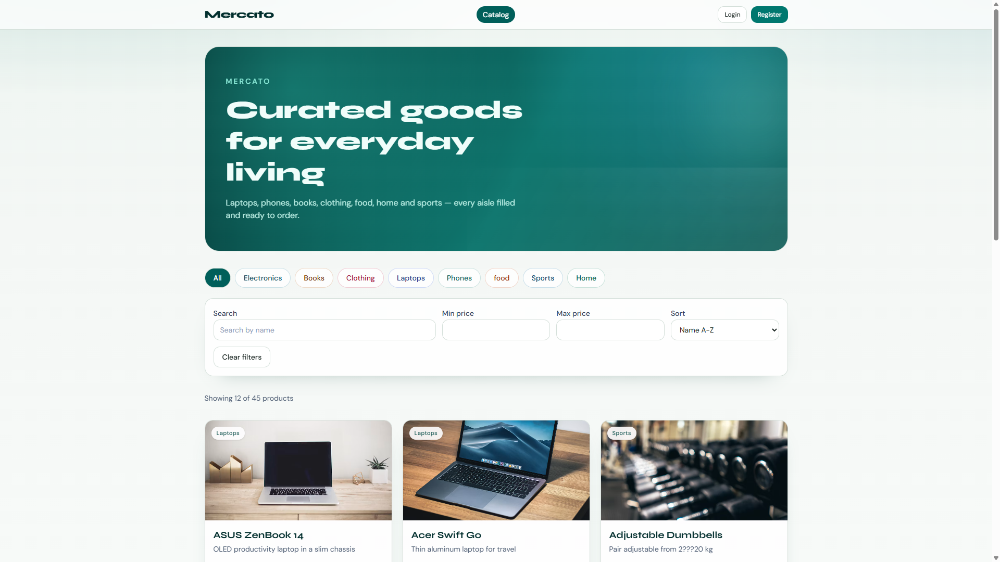
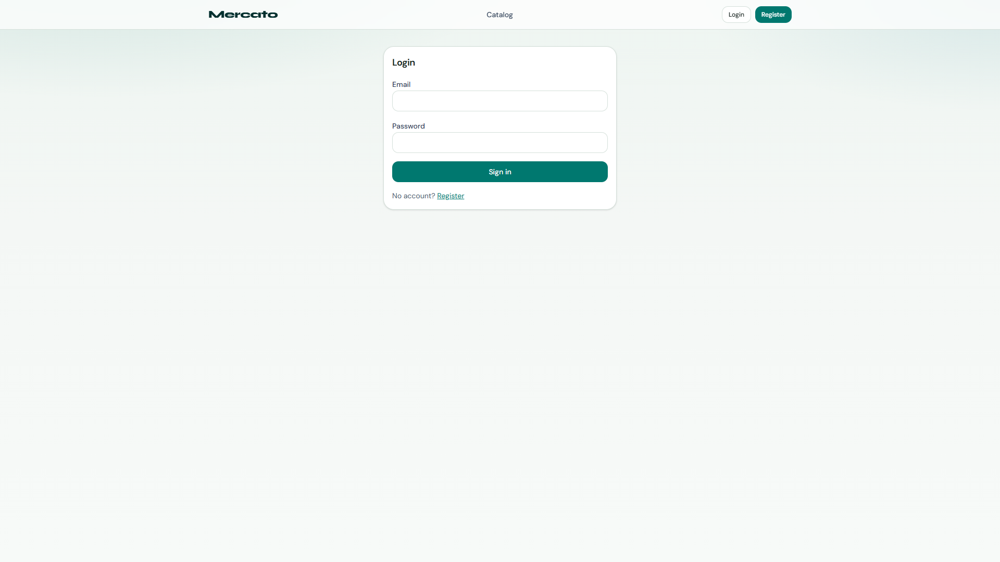
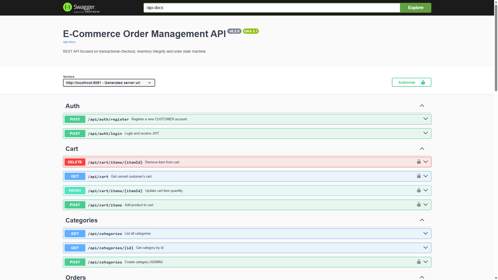
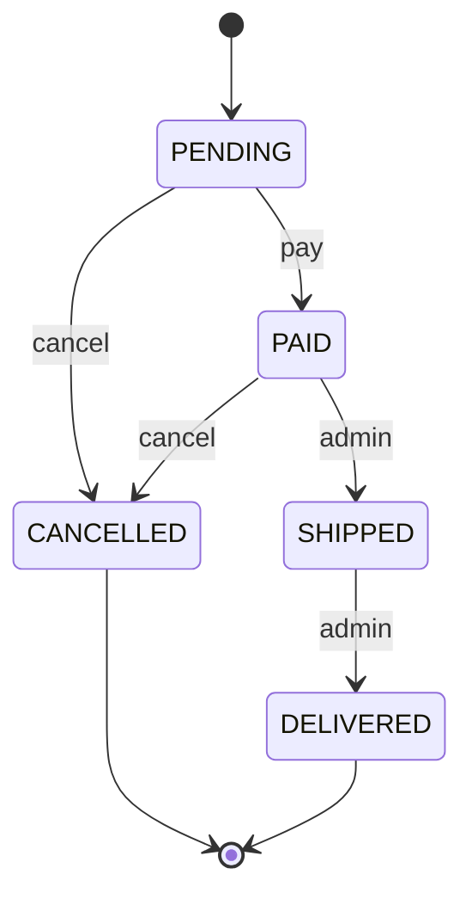
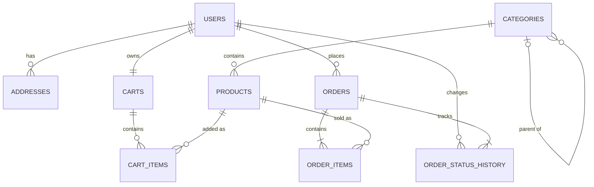

# E-Commerce Order Management API


Online store backend + React storefront focused on **data integrity**, **transactions**, **security** and **testing** — not feature count.

## Stack

| Layer | Technology |
|---|---|
| Backend | Java 21, Spring Boot 3.x |
| Persistence | Spring Data JPA, Flyway, PostgreSQL |
| Security | Spring Security + JWT |
| Validation | Jakarta Bean Validation |
| Mapping | MapStruct |
| Docs | springdoc-openapi (Swagger UI) |
| Frontend | React 19, TypeScript, Vite, Tailwind CSS, TanStack Query, React Hook Form + Zod, Axios, Sonner |
| Tests | JUnit 5, Mockito, MockMvc, Testcontainers, JaCoCo · Vitest (frontend) |
| Infra | Docker + docker-compose |
| CI | GitHub Actions (backend `mvn verify` + frontend lint/test/build) |

## Features

- [x] Product catalog (pagination / sorting / filters / images) + categories
- [x] JWT auth (`CUSTOMER` / `ADMIN`)
- [x] Cart with stock validation and totals
- [x] Transactional checkout, payment simulation, cancel + stock restore
- [x] Order status machine + history
- [x] Concurrency-safe stock reservation (pessimistic lock)
- [x] Admin product CRUD + order status transitions
- [x] React frontend (catalog, cart, checkout, orders, admin)
- [x] Tests + JaCoCo + CI workflow

### Demo users (seeded on startup)

| Role | Email | Password |
|---|---|---|
| ADMIN | `admin@shop.com` | `Admin123!` |
| CUSTOMER | `user@shop.com` | `User123!` |

Also kept for older local DBs: `admin@ecommerce.local` / `Admin123!`.

Catalog seed: Flyway `V3__seed_products.sql` (~40+ products across all categories).  
Product images: Flyway `V4__product_images.sql` (`image_url`).  
SKU `LAP-LAST-1` has **stock = 1** for concurrency demos.

> **Security note:** the SPA stores the JWT in `localStorage` for demo convenience. In production prefer an **httpOnly** cookie (reduces XSS token theft risk).

## Screenshots







> Tip: after login you can also capture Cart / Checkout / Orders / Admin and add more PNGs under `docs/screenshots/`.

## Order status machine



Illegal transitions are rejected (e.g. `SHIPPED → PENDING`). Cancel restores reserved stock.

## Quick start

### Option A — local API + Docker Postgres + Vite

```bash
docker compose up -d postgres
mvn spring-boot:run
cd frontend && npm install && npm run dev
```

| Service | URL |
|---|---|
| Frontend (Vite) | http://localhost:5173 |
| API | http://localhost:8081 |
| Swagger | http://localhost:8081/swagger-ui.html |
| Postgres (host) | `localhost:5433` |

Frontend env: `frontend/.env` → `VITE_API_URL=http://localhost:8081`

### Option B — full stack in Docker

```bash
docker compose up -d --build
```

| Service | URL |
|---|---|
| Frontend (nginx) | http://localhost:3000 |
| API | http://localhost:8081 |

Stop:

```bash
docker compose down
```

### Customer happy path

1. Register / login as CUSTOMER  
2. Browse catalog → add to cart  
3. Checkout with shipping address  
4. Pay order → watch status timeline  
5. (Optional) Admin ships / delivers the order  

### Admin happy path

1. Login as `admin@shop.com`  
2. `/admin/products` — create / edit / activate-deactivate  
3. `/admin/orders` — filter by status, apply allowed next status  

### Useful HTTP files

- `http/week1-products.http`
- `http/week2-auth-cart.http`
- `http/week3-orders.http`

## Tests

**Backend**

```bash
mvn test
mvn verify   # JaCoCo report: target/site/jacoco/index.html
```

Integration/concurrency tests use Testcontainers (Docker required).

**Frontend**

```bash
cd frontend
npm ci
npm run lint
npm test
npm run build
```

## Main endpoints

| Method | Path | Access |
|---|---|---|
| POST | `/api/auth/register`, `/api/auth/login` | public |
| GET | `/api/products`, `/api/categories` | public |
| POST/PUT/DELETE | `/api/products` | ADMIN |
| GET/POST/PATCH/DELETE | `/api/cart/**` | CUSTOMER |
| POST | `/api/orders` (checkout) | CUSTOMER |
| GET | `/api/orders`, `/api/orders/{id}` | CUSTOMER (own) |
| POST | `/api/orders/{id}/pay`, `/api/orders/{id}/cancel` | CUSTOMER |
| GET | `/api/orders/admin/all`, `/api/orders/admin/{id}` | ADMIN |
| PATCH | `/api/orders/{id}/status` | ADMIN |

Product payloads include optional `imageUrl` (create/update) and return it in responses.

## Deploy notes

Local/server deploy is the included Compose stack (`postgres` + `api` + `frontend`).

For a public host:

1. Change `POSTGRES_PASSWORD` and `APP_JWT_SECRET`  
2. Build frontend with a public API URL:  
   `VITE_API_URL=https://api.your-domain.com`  
3. Restrict CORS to your frontend origin  
4. Terminate HTTPS (Caddy / nginx / Cloudflare)

`VITE_API_URL` is baked in at **frontend build time** — `localhost` will not work for remote users.

## ER diagram


