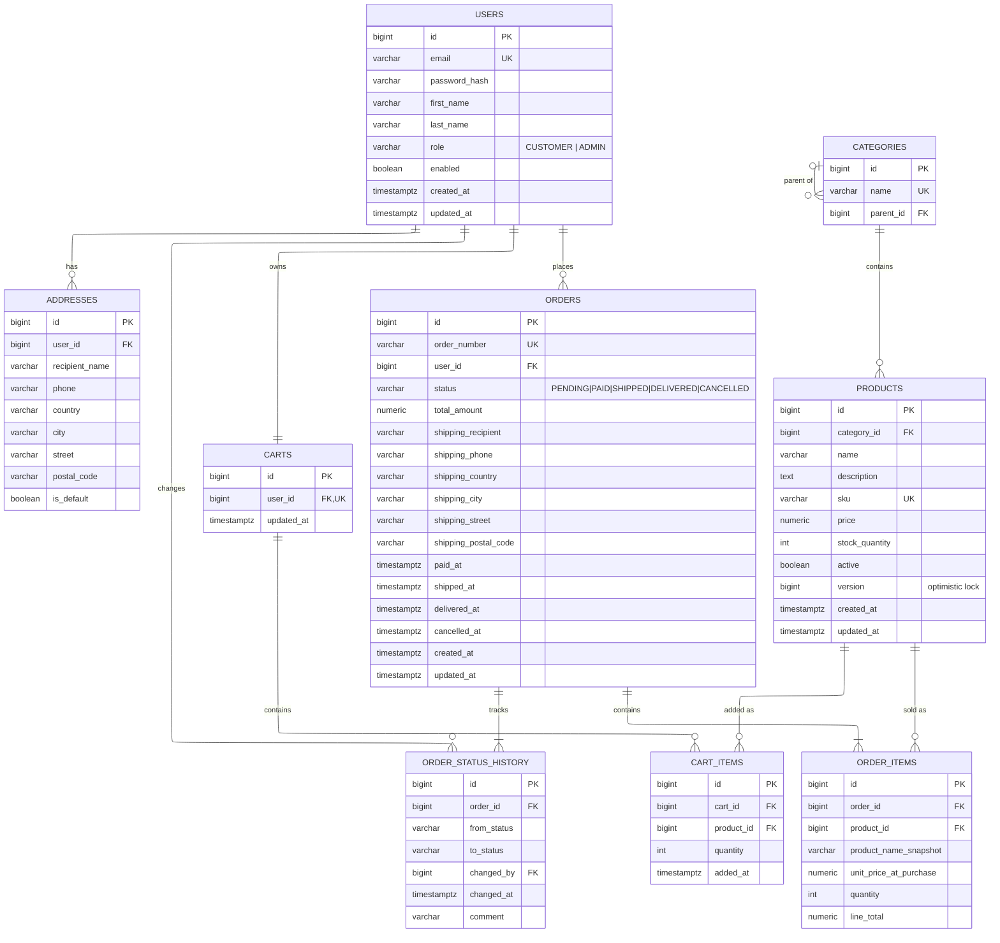

## Design decisions

### 1. Shipping address is copied into `orders` (snapshot)
`orders` stores the shipping address as plain columns instead of a foreign key to `addresses`. If a user edits or deletes an address later, historical orders must stay unchanged. An order is a legal and financial record of what was true at the time of purchase.

### 2. `unit_price_at_purchase` and `product_name_snapshot` in `order_items`
Product prices and names change over time. Storing them on the order line freezes the values the customer actually agreed to, so past orders and totals never change retroactively.

### 3. Optimistic locking with `products.version`
Two customers may try to buy the last unit at the same time. A `@Version` column makes the second transaction fail with `OptimisticLockException` instead of overselling. This is verified by a multi-threaded integration test.

### 4. Soft delete for products (`active = false`)
Products referenced by existing orders can never be physically deleted (`ON DELETE RESTRICT`). Deactivating hides them from the catalog while keeping order history intact.

### 5. `cart_items` and `order_items` are entities, not `@ManyToMany`
Both join tables carry their own data (quantity, price), so they are modeled as full entities with their own primary keys. A `UNIQUE (cart_id, product_id)` constraint prevents duplicate lines.

### 6. Append-only `order_status_history`
Every status change inserts a new row (who, when, from, to) and rows are never updated or deleted. This gives a full audit trail and makes it easy to answer "who shipped this order and when?".

### 7. `NUMERIC(12,2)` / `BigDecimal` for money
Floating-point types cause rounding errors. All monetary values use exact decimal types in both the database and Java.

### 8. Database-level constraints as a second line of defense
`CHECK (stock_quantity >= 0)`, `CHECK (price >= 0)`, enum `CHECK`s and unique indexes protect data integrity even if application code has a bug.

### 9. Schema managed by Flyway
No `ddl-auto=update`. Every schema change is a versioned, reviewable SQL migration.

